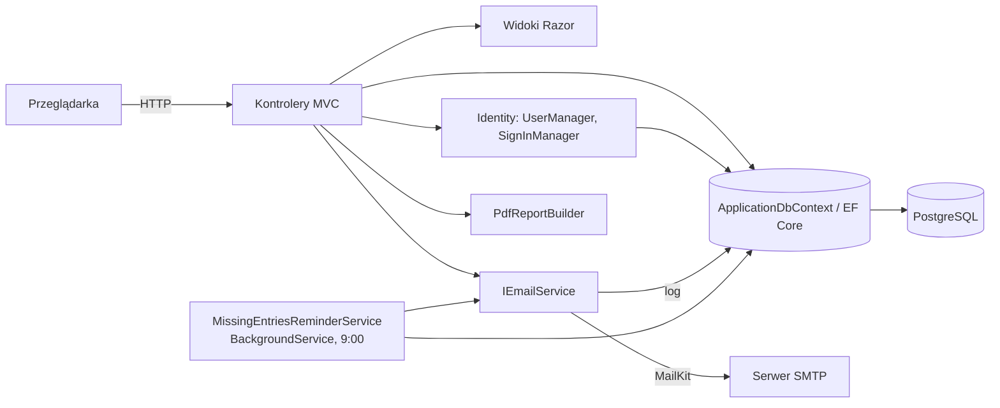
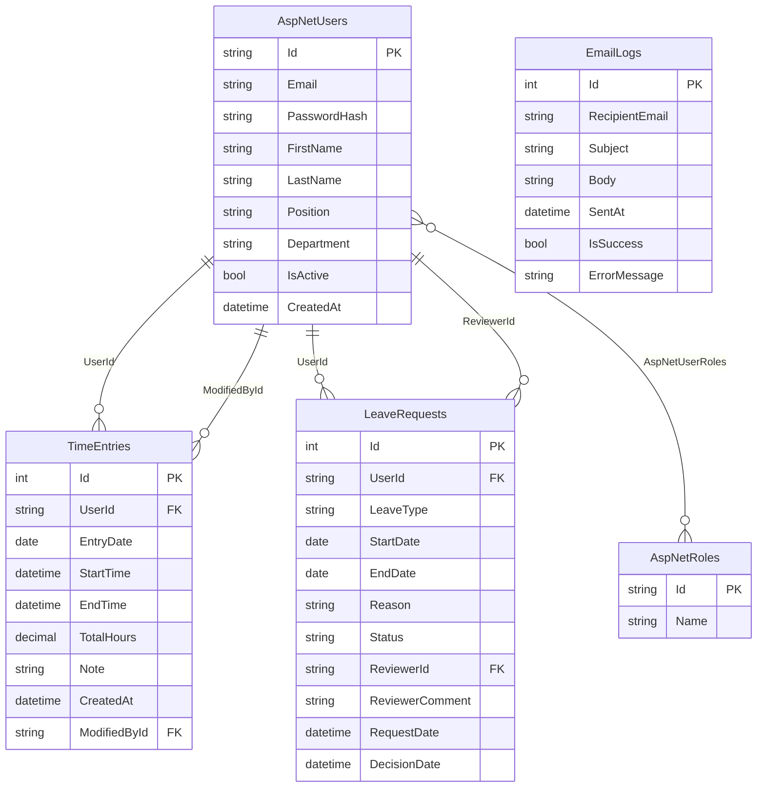
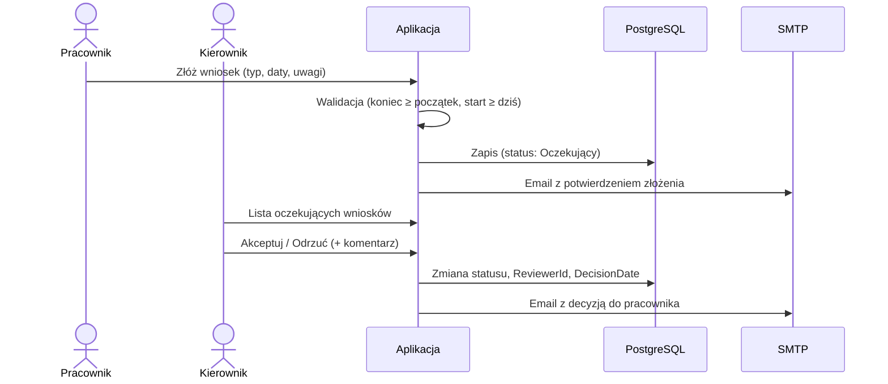
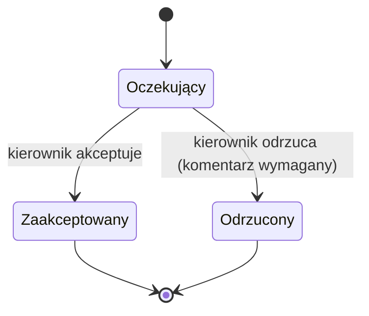

# Dokumentacja techniczna – TimeTrackingSystem

## 1. Technologie

| Warstwa        | Technologia                                   |
|----------------|-----------------------------------------------|
| Backend        | ASP.NET Core MVC (.NET 10)                    |
| Baza danych    | PostgreSQL 14+ (Npgsql + Entity Framework Core) |
| Autoryzacja    | ASP.NET Core Identity (cookie, role)          |
| Frontend       | Razor Views, Bootstrap 5, Bootstrap Icons     |
| Email          | MailKit (SMTP)                                |
| Dodatki        | Chart.js, FullCalendar, iTextSharp (PDF)      |

## 2. Architektura

Klasyczny MVC z warstwą usług. Kontrolery korzystają z `ApplicationDbContext` i `UserManager` (Identity), a wysyłkę emaili i generowanie PDF delegują do usług.

### Kontrolery

| Kontroler        | Rola dostępu                         | Zadanie                                              |
|------------------|--------------------------------------|------------------------------------------------------|
| Account          | anonimowy / zalogowany               | logowanie, zmiana i reset hasła, wylogowanie         |
| Admin            | Administrator                        | użytkownicy, role, raporty, eksport CSV/PDF          |
| TimeEntry        | wszystkie; zarządzanie: Admin/Kierownik | rejestracja czasu, historia, korekty              |
| LeaveRequest     | wszystkie; decyzje: Admin/Kierownik  | wnioski urlopowe i ich rozpatrywanie                 |
| LeaveCalendar    | zalogowani                           | kalendarz urlopów (JSON dla FullCalendar)            |
| Dashboard        | Administrator, Kierownik             | statystyki i wykresy                                 |

### Bezpieczeństwo

- hasła hashowane przez Identity, blokada konta po wielokrotnych błędnych logowaniach
- tokeny antyforgery (`[ValidateAntiForgeryToken]`) w formularzach POST
- globalny filtr wymagający uwierzytelnienia + `[Authorize(Roles = ...)]`
- ciasteczko HttpOnly, sesja wygasa po 15 min bezczynności (sliding)
- EF Core (zapytania parametryzowane) – brak SQL Injection
- sekrety (connection string, hasło SMTP) w User Secrets / zmiennych środowiskowych
- treści emaili w `EmailLogs` maskują hasła i tokeny

## 3. Model danych

Uwagi:
- `TotalHours` jest przeliczane automatycznie w `ApplicationDbContext.SaveChanges` dla dodanych/zmienionych wpisów.
- Daty/godziny przechowywane w UTC (`timestamptz`), `EntryDate` to lokalna data wpisu.
- Statusy wniosku: `Oczekujący`, `Zaakceptowany`, `Odrzucony`.

## 4. Kluczowe procesy

### Wniosek urlopowy

### Stany wniosku

### Ewidencja czasu pracy

1. „Rozpocznij pracę” – tworzy wpis (blokada: aktywny wpis lub wpis z dzisiejszą datą już istnieje → jeden wpis na dzień).
2. „Zakończ pracę” – ustawia `EndTime`, `TotalHours` liczone przy zapisie.
3. Kierownik/Administrator może skorygować wpis (wymagane uzasadnienie w `Note`, zapisywany `ModifiedBy`).

### Przypomnienia email

`MissingEntriesReminderService` (BackgroundService) codziennie o 9:00 (Europe/Warsaw, dni robocze) wysyła przypomnienie aktywnym pracownikom bez wpisu z poprzedniego dnia roboczego i bez zaakceptowanego urlopu.

## 5. Konfiguracja

| Klucz                              | Opis                         |
|------------------------------------|------------------------------|
| `ConnectionStrings:PostgreSQL`     | connection string do bazy    |
| `EmailSettings:*`                  | SmtpServer, SmtpPort, SenderEmail, SenderName, Username, Password, EnableSsl |

Wartości wrażliwe – w User Secrets (patrz README).